# UML Class Diagram & Architectural Specifications
## FreshSip Juice Bar Management System
**Course:** ICT 1306 — Object Oriented Programming  
**Institution:** Rajarata University of Sri Lanka  
**Language / Technology:** C++/CLI (.NET Framework 4.8 / Windows Forms / MySQL)

---

## 1. Complete System UML Class Diagram

```mermaid
classDiagram
    %% Abstract Base Class & Inheritance Hierarchy (OOP Concept D & C)
    class Person {
        <<abstract>>
        #int m_id
        #String^ m_name
        #String^ m_phone
        #String^ m_email
        +int Id
        +String^ Name
        +String^ Phone
        +String^ Email
        +GetDisplayText()* String^
        +GetRole()* String^
    }

    class Customer {
        -String^ m_address
        -DateTime m_registeredDate
        +String^ Address
        +DateTime RegisteredDate
        +GetRole() String^
        +GetDisplayText() String^
    }

    class Staff {
        -String^ m_role
        -String^ m_shift
        -Decimal m_salary
        +String^ Role
        +String^ Shift
        +Decimal Salary
        +GetRole() String^
        +GetDisplayText() String^
    }

    Person <|-- Customer : Inheritance
    Person <|-- Staff : Inheritance

    %% Product Entity (OOP Concept B: Encapsulation & F: Overloading)
    class Product {
        -int m_productId
        -String^ m_productName
        -String^ m_category
        -String^ m_description
        -Decimal m_price
        -int m_quantity
        -String^ m_imagePath
        -bool m_isActive
        +int ProductId
        +String^ ProductName
        +String^ Category
        +String^ Description
        +Decimal Price
        +int Quantity
        +String^ ImagePath
        +bool IsActive
        +CalculateSubtotal() Decimal
        +CalculateSubtotal(int quantity) Decimal
        +CalculateSubtotal(int quantity, Decimal discountPercentage) Decimal
        +ToString() String^
    }

    %% Ingredient Entity
    class Ingredient {
        -int m_ingredientId
        -String^ m_ingredientName
        -Decimal m_quantityInStock
        -String^ m_unitOfMeasure
        -Decimal m_reorderLevel
        -String^ m_supplierName
        -String^ m_supplierPhone
        -DateTime m_lastRestocked
        +int IngredientId
        +String^ IngredientName
        +Decimal QuantityInStock
        +String^ UnitOfMeasure
        +Decimal ReorderLevel
        +String^ SupplierName
        +String^ SupplierPhone
        +DateTime LastRestocked
        +bool IsLowStock
        +ToString() String^
    }

    %% Payment Abstraction & Polymorphism Hierarchy (OOP Concept C & E)
    class PaymentMethod {
        <<abstract>>
        +GetMethodName()* String^
        +ProcessPayment(Decimal amount, out String^ confirmationMessage)* bool
    }

    class CashPayment {
        -Decimal m_tenderedAmount
        -Decimal m_changeGiven
        +Decimal TenderedAmount
        +Decimal ChangeGiven
        +GetMethodName() String^
        +ProcessPayment(Decimal amount, out String^ confirmationMessage) bool
    }

    class CardPayment {
        -String^ m_cardType
        -String^ m_lastFourDigits
        -String^ m_authCode
        +String^ CardType
        +String^ LastFourDigits
        +String^ AuthCode
        +GetMethodName() String^
        +ProcessPayment(Decimal amount, out String^ confirmationMessage) bool
    }

    PaymentMethod <|-- CashPayment : Implements
    PaymentMethod <|-- CardPayment : Implements

    %% Order & Line Items (Aggregation & Overloading)
    class OrderItem {
        -int m_orderItemId
        -int m_orderId
        -int m_productId
        -String^ m_productName
        -int m_quantity
        -Decimal m_unitPrice
        -Decimal m_subtotal
        +int OrderItemId
        +int OrderId
        +int ProductId
        +String^ ProductName
        +int Quantity
        +Decimal UnitPrice
        +Decimal Subtotal
        +CalculateTotal() Decimal
        +CalculateTotal(int customQuantity) Decimal
        +CalculateTotal(int customQuantity, Decimal lineDiscount) Decimal
    }

    class Order {
        -int m_orderId
        -String^ m_orderNumber
        -Nullable~int~ m_customerId
        -String^ m_customerName
        -DateTime m_orderDate
        -Decimal m_subtotal
        -Decimal m_discount
        -Decimal m_finalTotal
        -String^ m_paymentMethod
        -String^ m_status
        -String^ m_notes
        -List~OrderItem^~ m_items
        +int OrderId
        +String^ OrderNumber
        +Nullable~int~ CustomerId
        +String^ CustomerName
        +DateTime OrderDate
        +Decimal Subtotal
        +Decimal Discount
        +Decimal FinalTotal
        +String^ PaymentMethodName
        +String^ Status
        +String^ Notes
        +List~OrderItem^~ Items
        +RecalculateTotals() void
        +GenerateOrderNumber()$ String^
    }

    Order *-- OrderItem : Composition (1 to *)
    OrderItem --> Product : References

    %% Service Layer (Separation of Concerns)
    class ProductService {
        +GetAllProducts()$ List~Product^~
        +GetActiveProducts()$ List~Product^~
        +GetProductById(int id)$ Product^
        +SearchProducts(String^ kw, String^ cat)$ List~Product^~
        +AddProduct(Product^ p, out String^ err)$ bool
        +UpdateProduct(Product^ p, out String^ err)$ bool
        +DeleteProduct(int id, out String^ err)$ bool
        +UpdateStock(int id, int delta, out String^ err)$ bool
    }

    class CustomerService {
        +GetAllCustomers()$ List~Customer^~
        +GetCustomerById(int id)$ Customer^
        +SearchCustomers(String^ kw)$ List~Customer^~
        +AddCustomer(Customer^ c, out String^ err)$ bool
        +UpdateCustomer(Customer^ c, out String^ err)$ bool
        +DeleteCustomer(int id, out String^ err)$ bool
    }

    class InventoryService {
        +GetAllIngredients()$ List~Ingredient^~
        +GetLowStockIngredients()$ List~Ingredient^~
        +SearchIngredients(String^ kw)$ List~Ingredient^~
        +GetLowStockCount()$ int
        +AddIngredient(Ingredient^ i, out String^ err)$ bool
        +UpdateIngredient(Ingredient^ i, out String^ err)$ bool
        +UpdateStockQuantity(int id, Decimal qty, out String^ err)$ bool
        +DeleteIngredient(int id, out String^ err)$ bool
    }

    class OrderService {
        +ProcessAndSaveOrder(Order^ o, PaymentMethod^ pay, out String^ rcpt, out String^ err)$ bool
        +GetRecentOrders(int limit)$ List~Order^~
        +GetOrdersByDateRange(DateTime s, DateTime e)$ List~Order^~
        +GetOrderItems(int orderId)$ List~OrderItem^~
        +GetOrderByNumber(String^ num)$ Order^
    }

    class ReportService {
        +GetTodaySalesTotal()$ Decimal
        +GetTodayOrderCount()$ int
        +GetTotalOrdersCount()$ int
        +GetAvailableProductsCount()$ int
        +GetTopSellingProducts(int limit)$ List~ProductSalesSummary^~
        +GetRevenueSummary(DateTime s, DateTime e)$ List~DailyRevenueSummary^~
    }

    %% Data Infrastructure
    class DatabaseManager {
        -String^ s_connectionString$
        +InitializeConnectionString()$ void
        +GetConnectionString()$ String^
        +SetConnectionString(String^ s)$ void
        +CreateConnection()$ MySqlConnection^
        +TestConnection(out String^ err)$ bool
        +ExecuteQuery(String^ sql, MySqlParameter[] params)$ DataTable^
        +ExecuteNonQuery(String^ sql, MySqlParameter[] params)$ int
        +ExecuteScalar(String^ sql, MySqlParameter[] params)$ Object^
    }

    %% Presentation Layer
    class MainForm {
        -Order^ m_currentPosOrder
        -String^ m_lastReceiptText
        +MainForm()
        -InitializeCustomLayout() void
        -SwitchScreen(Panel^ target, String^ title) void
        -OnPosAddToCart(Object^ s, EventArgs^ e) void
        -OnPosCheckout(Object^ s, EventArgs^ e) void
        -OnPaintReportChart(Object^ s, PaintEventArgs^ e) void
    }

    class ReceiptForm {
        -String^ m_receiptText
        +ReceiptForm(String^ receiptText)
        -OnPrintClick(Object^ s, EventArgs^ e) void
    }

    MainForm --> OrderService : Coordinates
    MainForm --> ProductService : Coordinates
    MainForm --> CustomerService : Coordinates
    MainForm --> InventoryService : Coordinates
    MainForm --> ReportService : Coordinates
    MainForm --> ReceiptForm : Instantiates
    OrderService --> PaymentMethod : Dispatches Polymorphically
    ProductService --> DatabaseManager : Uses
    CustomerService --> DatabaseManager : Uses
    InventoryService --> DatabaseManager : Uses
    OrderService --> DatabaseManager : Uses
    ReportService --> DatabaseManager : Uses
```

---

## 2. Mapping of Mandatory OOP Concepts

| Concept | Implemented Class / Interface | Structural Mechanism | Real-World Application in System |
| :--- | :--- | :--- | :--- |
| **A. Class & Object** | `Product`, `Customer`, `Order`, `OrderItem`, `Ingredient`, `Staff` | Instantiated via `gcnew` on CLR managed heap | Encapsulates entity state and behavior across shopping cart, catalog, and inventory. |
| **B. Encapsulation** | `Product`, `Ingredient`, `OrderItem` | Private fields (`m_price`, `m_quantity`), public properties with validation | Prevents negative prices and negative stock levels by raising `ArgumentException`. |
| **C. Abstraction** | `PaymentMethod` (abstract ref class) | Pure virtual `ProcessPayment(...)` and `GetMethodName()` | Defines the universal billing contract without exposing payment gateway internal algorithms. |
| **D. Inheritance** | `Person` (Base) -> `Customer`, `Staff` (Derived) | `public ref class Customer : public Person` | Reuses common identity attributes (`Name`, `Phone`, `Email`) while extending specific role behaviors. |
| **E. Polymorphism** | `PaymentMethod^` handle dispatching `CashPayment` or `CardPayment` | Dynamic late-binding virtual method dispatch | The POS checkout engine executes `paymentMethod->ProcessPayment(...)` seamlessly regardless of cash or card selected. |
| **F. Method Overloading** | `Product::CalculateSubtotal(...)`, `OrderItem::CalculateTotal(...)` | Multiple signatures with differing parameter lists | Enables flexible subtotal evaluation: base unit price, unit price x quantity, or quantity with applied discount. |
